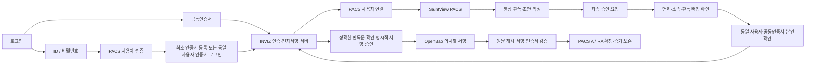

# PACS 로그인과 판독 승인 실행 구조

2026-10-17 변경: 판독의사가 PACS에서 공동인증서를 직접 등록하고, 이후에도 매번 공동인증서로 로그인한다. 관리자 사전등록·초대 발급과 기존 초대 기반 등록을 기본 차단한다.

최초 로그인 → PACS 계정·면허·소속 조회 → 공동인증서 검증·동의 → 인증서와 의사 정보의 연결 검토 → 활성화 → 공동인증서 로그인 → PACS 진입 순서다. 비밀번호 계정 확인만으로는 의사 일반 API에 접근할 수 없다. 판독문 승인 단계의 서명 검증은 유지한다. [최초 등록 API](../apps/backend/docs/PACS_SELF_ENROLLMENT.md)를 참고한다.

## 구현 연결

- 등록된 판독의사는 공동인증서로 로그인한다. ID/PW 세션은 계정 연결·등록과 인증서 로그인 전환에만 사용한다. 직원 계정 및 연동 비활성 환경은 기존 정책을 따른다.
- 비밀번호로 본인 계정을 확인한 상태에서 PACS 진입 전에 인증 팝업을 열고, `POST /api/vc/auth/certificate-step-up`에 기존 PACS bearer와 일회성 handoffCode를 보낸다.
- 서버는 코드에 연결된 의사와 **현재 로그인한 PACS 사용자**가 같은지 확인한 뒤 `vc1` 세션을 발급한다. 다른 계정의 인증서로 사용자가 바뀌는 것을 허용하지 않는다.
- 팝업 응답은 지정된 origin, 해당 popup 객체, 암호학적 난수 nonce 및 audience가 모두 일치해야 수신한다. 코드·bearer는 URL/로컬 저장소에 보관하지 않는다.
- 본인확인 후 사용자가 판독문을 확인하고 다시 승인하면 원문 스냅샷을 생성한다. INVIZ에서 문서별 명시적 승인과 실제 서명을 마친 후 PACS가 서명값과 상태를 확인해 A/RA를 저장한다.
- 서명 후 로컬 저장에 실패해도 승인 완료로 표시하지 않는다. 서명 증거를 보존하고 재처리한다.

## 면허와 자격 범위

현재 비교 필드는 PACS의 `doctor_license_number`와 INVIZ 의사 계정의 `licenseNumber`다. 어느 한쪽이 없거나 다르면 로그인을 통한 인증 연결을 거부한다. 면허번호를 입력했다는 사실만으로 본인인증에 성공하지 않는다.

이 비교는 관리자가 검토한 의사면허 정보의 일치 확인이다. 별도의 전문의 자격번호, 정부 면허 조회, 과목별 전문의 자격 검증을 구현했다고 주장하지 않는다. 그 자격을 별도로 관리하는 PACS 필드와 검증기관 계약이 확인되면 추가 검증 조건으로 연결해야 한다.

## 검증과 적용 한계

서버 연결·동일 사용자 재인증·면허 불일치·인증서 변경·재전송·최종 승인 통제는 PACS Python 테스트 53개로 확인했다. 실제 로컬 Java/PostgreSQL/OpenBao/MariaDB 연동 검증도 통과했다. 웹 프로젝트 빌드는 성공했다. 원본 SV70 전체 클라이언트 빌드는 설치되지 않은 React 등 외부 의존성으로 검증되지 않았으며, 실제 PACS 배포는 별도 적용이 필요하다.

연결 주소와 설정은 [내부망 연결 정보](PACS_LAN_CONNECTION.md), 배포용 변경 파일은 [SV70 묶음](../integrations/sv70/README.md)을 따른다.
