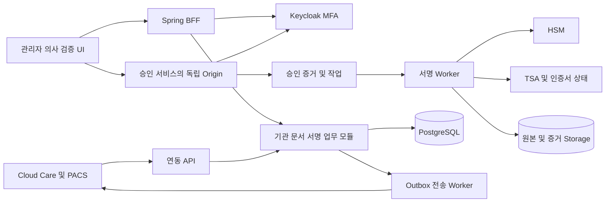

> 2026-10-13 설계 변경: [[12_인증서등록_설계변경]]을 우선 적용한다. 관리자 사전등록 → PC 공동인증서/모바일 인증서 검증·의사 연결 → 본인 동의 → OpenBao ECDSA P-256 키·INVIZ 자체 인증서 활성화로 변경했다. Google은 보조 연동이며 기본 인증서 필수 정책을 우회하지 않는다. 아래 원문 기반 계획의 Keycloak·RSA/HSM 초기 구성과 충돌하는 부분은 이 변경서로 대체한다.
---
title: 시스템 아키텍처와 보안 경계
project: Vision-Certi
version: 1.0
date: 2026-10-13
status: ready-for-development
owner: Codex
---

# 시스템 아키텍처와 보안 경계

업무 API를 모듈형 백엔드로 시작하되 사용자 승인과 HSM 사용을 별도 서비스·운영 권한으로 분리한다. 일반 관리자와 업무 API 계정은 승인 증거 없이 서명할 수 없어야 한다.

## 구성

| 구성 | 책임 | 접근 제한 |
|---|---|---|
| BFF·Core | 기관·자격·문서·조회·작업 접수 | HSM 직접 접근 금지, 승인 서명키 접근 금지 |
| Approval | 승인 화면 제공, 사용자 인증 확인, 해시 결속, 일회성 승인 발급 | 별도 OIDC 클라이언트·세션·배포 권한, Core의 사용자 헤더를 신뢰하지 않음 |
| Sign Worker | 승인 검증, 권한 재검사, HSM·TSA 호출, 결과 조정 | 공개 인터넷 호출 불가, 최소 DB 역할 |
| Verify 모듈 | 원본·서명·체인·시점·정책 검증 | HSM 없이 검증 가능, 신뢰 루트는 서버 정책으로 고정 |
| Delivery Worker | 전송·ACK·재시도 | 등록·승인된 병원 목적지만 접근 |
| Keycloak | OIDC 로그인·MFA·세션 | 운영자 impersonation 금지, 복구·초기화 별도 통제 |
| Storage | 버전 고정 원본·서명·증거·감사 체크포인트 | 기관별 접근 검사, 운영 보존 객체 삭제 금지 |

승인 UI는 Approval 서비스가 통제하는 별도 Origin에서 top-level 페이지로 제공한다. antigravity가 UI를 구현하되 배포 소유자는 Approval 보안 경계다. 동일 IdP SSO를 사용해 정상 로그인 후 반복 비밀번호 입력을 줄인다. Core가 만든 임의 이벤트만으로 승인 서비스를 대신할 수 없다. 팝업에 의존하지 않고 승인 후 allowlist의 원래 화면으로 복귀한다.

## 신원과 세션

사용자 식별자는 OIDC `iss＋sub`로 매핑한다. 이름·이메일·전화번호를 계정 결합의 유일 키로 사용하지 않는다. 여러 기관 소속은 하나의 의사 신원에 연결하되 기관별 권한 이력을 보존한다.

브라우저는 Secure·HttpOnly 쿠키, CSRF 토큰과 Origin 검사를 사용한다. OIDC Authorization Code＋PKCE를 적용하고 리다이렉트 주소를 고정한다. 기관 간 시스템 호출은 mTLS와 서비스 자격, 기관별 scope를 함께 검사한다.

개발 기본 정책: Access Token 5분, 유휴 15분, 절대 세션 8시간. OTP 3분, 최대 5회, 재전송 60초, 계정당 시간당 10회 발송. 계정·전화번호·IP 제한을 함께 적용한다. 자동 polling은 유휴 시간을 연장하지 않는다. 실제 병원 정책은 더 엄격하게 설정할 수 있으며 운영에서 완화할 때 보안 검토를 거친다.

새 기기·허용 네트워크 이탈·관리자 위험 플래그는 Step-up 대상으로 한다. 세션 만료·토큰 이상은 재로그인, 면허·권한 무효는 차단이다. 기기 식별은 최소한의 임의 식별자를 사용하고 기기 fingerprint를 불필요하게 수집하지 않는다.

## 서명 프로토콜

1. 연동 API가 PDF를 수신한다. 검사·판독문 외부 ID는 기관·connector 범위에서만 유일하다.
2. 바이러스·형식·크기 검사를 통과한 정확한 바이트를 Object Storage에 저장한다. 서버가 SHA-256을 계산하고 불변 버전을 만든다.
3. 요청은 `tenant_id, signer_id, document_version_id, document_sha256, credential_id, policy_version`에 결합한다. 요청 TTL은 개발 기본 10분이다.
4. 승인 서비스는 자신의 인증 세션과 권한으로 요청을 읽고 동일 버전을 보여준다. 클릭 시 문서·서명자·기관과 정책을 재검사한다.
5. Approval 서비스가 nonce와 승인 증거를 영속화한다. JWS 증거에는 issuer, audience, jti, issued_at, expires_at, auth_context_ref 및 요청의 결합 필드를 포함한다. 승인 실행 기한은 개발 기본 120초다.
6. Worker는 승인 서명·audience·만료·DB nonce 상태를 검사하고 단일 작업으로 점유한다. HSM 호출 직전에 면허·기관 권한·인증서 상태를 다시 읽는다.
7. 의사 키로 CAdES 서명을 생성한다. 최초 개발 프로파일은 SHA-256＋RSA 3072/PKCS#1 v1.5이며 자체 RSA 구현을 금지한다. 실제 HSM의 지원·보안 적합성은 공급자 시험으로 확인하고 변경 시 ADR을 남긴다.
8. RFC 3161 타임스탬프, 체인, 폐기 상태 응답을 수집하고 신뢰정책에 따라 검증한다. 보존 저장과 독립 검증이 끝나야 `COMPLETED`다.
9. 완료 Outbox로 병원 전송을 시작한다. 화면에는 서명과 병원 전송 상태를 각각 표시한다.

PDF를 렌더링한 뒤 다시 생성한 파일이나 HTML 문자열을 원본 대신 서명하지 않는다. 미리보기와 서명 대상은 같은 객체 버전이다. PDF 미리보기는 스크립트·외부 리소스 접근을 제한한다. 표시가 불가능한 문서는 승인하지 못하게 한다.

## 상태와 장애 경계

| 상태 | 다음 동작 | 사용자 표시 |
|---|---|---|
| PENDING_APPROVAL | 사용자 승인·거절·요청 만료 | 서명 전 |
| APPROVED | 유효 기한 내 Worker 점유 | 승인 완료·처리 대기 |
| SIGNING | HSM 결과 확보 | 서명 처리 중 |
| EVIDENCE_PENDING | 기존 서명에 TSA·검증 증거 추가 | 증거 처리 중 |
| COMPLETED | 전송·후속 검증 | 서명 완료 |
| EXPIRED / REJECTED | 새 요청 필요 | 만료·거절 |
| FAILED | 명확한 영구 오류 기록 | 실패와 조치 안내 |
| RECONCILIATION_REQUIRED | 기존 결과 조회·관리자 조정 | 결과 확인 중 |

승인 기한 이후 아직 시작하지 않은 HSM 호출은 금지한다. 이미 생성된 서명의 증거 수집은 기한 이후 재개할 수 있다. HSM timeout은 성공 여부가 불명확하므로 `FAILED`로 단정하지 않는다. 공급자가 결과 조회를 제공하지 않으면 자동 재서명을 금지하고 운영 조정으로 보낸다.

동시 철회와 실행은 기관 권한 버전을 실행 허가 시점에 원자적으로 확인한다. 허가 이전에 커밋된 철회는 반드시 차단한다. HSM 호출이 이미 시작된 뒤 도착한 철회는 호출을 되돌릴 수 없으므로 경합 사건으로 감사 기록하고 결과를 보존한다.

서명 레코드와 불변 객체는 서로 다른 저장소에 있으므로 원자 트랜잭션으로 묶인다고 가정하지 않는다. 단계별 job journal, 결정적 객체 키, 체크섬, 재조정 작업으로 복구한다. 영속 객체·검증 결과·완료 Outbox가 일치하기 전에는 완료 응답하지 않는다.

## 장기 증거

증거 패키지는 스키마 버전, 원본 해시, 의사·기관·문서 버전, 인증서 체인, 폐기 증거, TSA 토큰, 승인 증거 참조·해시, 정책 스냅샷, 감사 체크포인트 참조를 포함한다. 환자 원문·세션 토큰·OTP를 넣지 않는다.

병원 ACK는 최초 서명 증거 생성 시점에 존재하지 않는다. ACK가 도착하면 별도 전달 증거를 추가하고 최초 패키지를 수정하지 않는다. 장기 증거 갱신도 `generation`이 증가한 별도 객체로 저장한다.

검증기는 패키지가 제공한 루트를 무조건 신뢰하지 않는다. 기관별 승인된 신뢰정책과 검증 시점·서명 당시 시점을 구분한다. 증거가 없으면 `INDETERMINATE`, 위변조가 입증되면 `INVALID`다.

## 위협모델과 운영 한계

| 위협 | 통제 | 검증 |
|---|---|---|
| 타기관 ID 추측 | API 검사＋RLS＋객체 권한 | SEC-T01 |
| 문서 교체·승인 재사용 | 불변 해시·버전 결속·nonce 1회 사용 | SIGN-T02, SEC-T03 |
| 일반 관리자 대리서명 | 독립 승인 Origin·IdP 세션·HSM 역할 분리 | SEC-T03 |
| IdP 복구 권한 악용 | 이중 승인·알림·재검증·기존 세션 철회 | SEC-T04 |
| 로그 일부 삭제 | 체인＋별도 WORM 체크포인트 | AUDIT-T01 |
| 악성 PDF·SSRF | 업로드 검사·미리보기 격리·connector 목적지 allowlist | SEC-T05 |
| 인프라 전체 장악·운영자 공모 | 배포 승인 분리·독립 감사·실제 HSM 승인 결속 검증 | SEC-001 운영 심사 |

일반 서버 세션과 HSM만으로 모든 운영자에게서 의사의 단독 통제를 암호학적으로 보장할 수는 없다. 병원 정책이 의사 소유 요소의 매 거래 증명을 요구하면 Passkey 등 거래별 승인으로 UX와 프로토콜을 변경해야 한다. 이 조건은 EXT-002의 운영 출시 판단 항목이다.

관련 계약: [[03_DB_데이터사전]], [[04_API_연동계약]], [[11_외부의존성_결정대장]].
