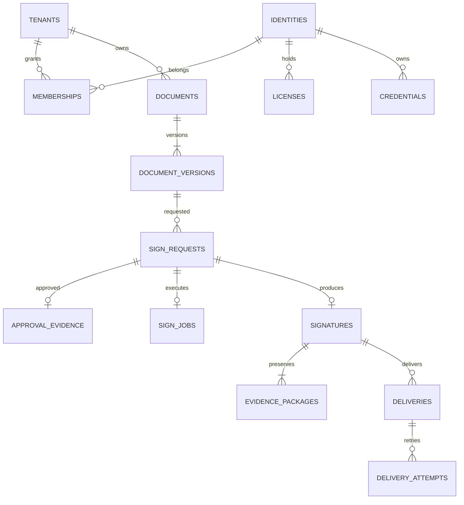

> 2026-10-13 설계 변경: [[12_인증서등록_설계변경]]을 우선 적용한다. 관리자 사전등록 → PC 공동인증서/모바일 인증서 검증·의사 연결 → 본인 동의 → OpenBao ECDSA P-256 키·INVIZ 자체 인증서 활성화로 변경했다. Google은 보조 연동이며 기본 인증서 필수 정책을 우회하지 않는다. 아래 원문 기반 계획의 Keycloak·RSA/HSM 초기 구성과 충돌하는 부분은 이 변경서로 대체한다.
---
title: 데이터베이스 설계와 데이터 사전
project: Vision-Certi
version: 1.0
date: 2026-10-13
status: ready-for-development
owner: Codex
---

# 데이터베이스 설계와 데이터 사전

PostgreSQL에는 업무 메타데이터·승인 상태·작업 이력을, Object Storage에는 원본·서명·증거 바이트를 저장한다. Codex가 DDL과 Flyway를 소유하며 Claude는 Hibernate 자동 DDL을 사용하지 않는다.

## 공통 규칙

- 키는 UUID, 시각은 UTC `timestamptz`, 해시는 소문자 SHA-256 64자리다. 화면에서만 Asia/Seoul로 변환한다.
- 기관 테이블은 `(tenant_id,id)` 유일 제약과 기관을 포함한 복합 외래키를 사용한다. 공유 신원 데이터는 일반 기관 계정에 직접 공개하지 않는다.
- 모든 업무 조회는 tenant 조건과 RLS를 함께 사용한다. 트랜잭션에서 `SET LOCAL app.tenant_id`를 설정하고 연결 반환 시 누출이 없는지 시험한다.
- DB 소유자·migration 역할과 업무 역할을 분리한다. 업무 역할에 BYPASSRLS, SUPERUSER, TRUNCATE, DDL 권한을 주지 않는다. RLS 대상은 FORCE ROW LEVEL SECURITY를 적용한다.
- 민감정보 원문은 최소 수집하고 암호화된 참조로 분리한다. 개인키·OTP 원문·토큰은 금지한다.
- 상태 필드는 허용 값 CHECK와 서비스 전이 검증을 함께 사용한다. 기록 삭제를 soft delete로 일괄 대체하지 말고 보존 목적별로 설계한다.

## 논리 관계

## 테이블별 필드

모든 테이블의 기본 `id`, `created_at`은 아래에서 생략한다. `tenant_id`는 기관 소속 테이블에 필수다.

| 테이블 | 핵심 필드 | 제약·인덱스 |
|---|---|---|
| tenants | code, name, status | code unique |
| tenant_policies | tenant_id, version, policy_json, approved_by, effective_at | tenant＋version unique; 기존 정책 불변 |
| identities | oidc_issuer, oidc_subject, display_name, status | issuer＋subject unique; 제한된 신원 서비스만 조회 |
| identity_proofs | identity_id, proof_type, evidence_ref, verified_by, verified_at | 근거 원문 분리·접근 감사 |
| licenses | identity_id, license_ref, status, verified_at, valid_until | 면허번호 노출 최소화 |
| license_reviews | license_id, reviewer_id, decision, reason, evidence_ref | 추가 전용 심사 이력 |
| memberships | tenant_id, identity_id, role, valid_from, valid_to, status, authority_version | tenant＋identity＋role unique |
| membership_history | tenant_id, membership_id, before_state, after_state, reason, actor_id | 추가 전용 |
| credentials | identity_id, serial, issuer_ref, key_ref, algorithm, not_before, not_after, status | issuer＋serial unique; 개인키 없음 |
| credential_events | credential_id, type, actor_id, reason, occurred_at | 발급·갱신·폐기 이력 |
| revocation_records | credential_id, revoked_at, invalidity_at, reason_code, publication_ref | 폐기와 유출 추정 시점을 구분 |
| documents | tenant_id, connector_id, external_document_id, external_study_id, title | tenant＋connector＋external_document_id unique |
| document_versions | tenant_id, document_id, version_no, previous_version_id, object_key, object_version, sha256, byte_length, content_type, amendment_reason | tenant＋document＋version unique; 바이트·참조 UPDATE/DELETE 금지 |
| sign_requests | tenant_id, document_version_id, signer_id, credential_id, nonce_digest, doc_hash, policy_version, state, expires_at | tenant＋nonce_digest unique; state＋created_at index |
| approval_evidence | tenant_id, request_id, jti, approval_object_ref, approval_hash, auth_context_ref, approved_at, expires_at | request unique, jti unique; nonce 원문 로깅 금지 |
| sign_jobs | tenant_id, request_id, lease_owner, lease_until, state, attempts, execution_ref, last_error_code | request unique; 실행 결과 불명 상태 보존 |
| signatures | tenant_id, request_id, signer_id, credential_id, document_version_id, signature_object_ref, signed_at, mode | request unique; 서명 결과 불변 |
| evidence_packages | tenant_id, signature_id, generation, object_key, sha256, timestamp_at, verification_status | signature＋generation unique; 추가 전용 |
| verification_runs | tenant_id, signature_id, evidence_generation, status, checks_json, policy_version, verified_at | signature＋verified_at index |
| connectors | tenant_id, type, endpoint_ref, credential_ref, enabled | 비밀값이 아닌 Secret Manager 참조 |
| deliveries | tenant_id, signature_id, connector_id, event_type, state, next_attempt_at, ack_ref | signature＋connector＋event_type unique |
| delivery_attempts | tenant_id, delivery_id, attempt_no, sent_at, response_code, ack_ref, error_code | delivery＋attempt_no unique; 환자 본문 기록 금지 |
| outbox_events | tenant_id, aggregate_type, aggregate_id, event_type, payload, available_at, processed_at | 미처리 부분 인덱스; 최소 참조만 payload에 포함 |
| audit_events | tenant_id, sequence_no, actor_id, action, target_type, target_id, correlation_id, previous_hash, event_hash, occurred_at | tenant＋sequence unique; 추가 전용 |
| audit_checkpoints | tenant_id, last_sequence, last_hash, object_ref, anchored_at | tenant＋last_sequence unique; 독립 저장 |
| idempotency_records | tenant_id, actor_id, route_key, idempotency_key, request_hash, response_ref, status, expires_at | tenant＋actor＋route＋key unique |

글로벌 신원과 인증서는 기관별 projection API를 통해 노출한다. 기관 관리자가 의사의 타기관 소속·서명 이력을 볼 수 없게 한다.

## 일관성과 동시성

서명 요청의 논리 결과는 하나만 존재하도록 request unique 제약을 둔다. 작업 점유는 `FOR UPDATE SKIP LOCKED`와 제한된 lease를 사용한다. lease 만료만으로 HSM을 다시 호출하지 말고 execution_ref로 이전 결과를 먼저 조정한다.

승인·작업·Outbox는 같은 DB 트랜잭션으로 기록한다. 외부 호출 동안 장시간 DB 락을 유지하지 않는다. 원본 객체 저장 이후 DB 실패로 생긴 orphan은 manifest 대조로 식별하고, 운영 보존 정책에 따라 처리한다. 활성 요청·보존 객체를 정리 작업이 삭제하지 못하게 한다.

서명 증거 generation은 누적되며 delivery ACK는 별도 증거로 연결한다. 상태 갱신용 테이블과 원본·증거 불변 테이블을 분리해 정상 Worker 상태 갱신을 불변 트리거가 막지 않도록 한다.

## 마이그레이션과 용량

V001 공통 기관·신원, V002 문서·요청·서명, V003 감사·Outbox·전송, V004 RLS·역할·불변성, V005 운영 인덱스 순으로 분리한다. 개발 fixture는 운영 migration과 분리한다. 배포 롤백은 파괴적 down migration 대신 이전 API 호환과 forward fix를 사용한다.

하루 10만 건에서 평균 PDF 500KB를 가정하면 원본만 약 50GB/일이다. 평균 크기는 측정 전 가정이며 서명·증거·복제·백업 용량을 추가해야 한다. 환자 원본을 DB bytea로 저장하지 않는다. 감사 테이블 partition은 실제 쿼리와 증가량을 측정한 뒤 적용한다.

DB 시험: 두 기관 교차 조회·쓰기 차단, 누락 tenant 거부, 커넥션 재사용 누출, 교차 tenant FK, 버전 변경·삭제 거부, 중복 승인 경쟁, migration 신규 설치·업그레이드. 관련 작업은 [[06_작업분해_의존성]]의 DB-001~003이다.
