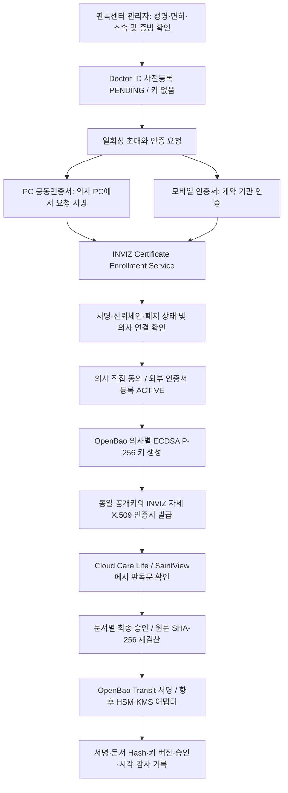

# 인증서 등록·검증·활성화 설계 변경 — 2026-10-13

이 문서는 2026-10-13 사용자가 확정한 변경 요구사항이다. 원본 PDF의 과거 설계와 충돌하면 이 문서의 인증 흐름·키 생성 시점·알고리즘을 우선 적용한다. 원본 PDF 자체는 수정하지 않는다.

## 확정 구조

공동인증서·모바일 인증서는 **로그인과 의사 인증용**이다. OpenBao 키와 INVIZ 자체 인증서는 **판독문 전자서명용**이다. 외부 공동인증서 개인키로 판독문을 서명한 것으로 표시하지 않는다. Google OIDC 연동은 보조 경로이며 기본 `CERTIFICATE_REQUIRED` 정책에서 인증서 검증을 생략하지 못한다.

## 역할과 상태

관리자는 성명, 면허번호, 센터, 초대 이메일, 신원·면허 증빙 참조를 등록한다. 초대코드는 한 번만 표시하며 자동 이메일 발송으로 오인시키지 않는다. 초대만으로 실제 신원 검증이 끝난 것으로 처리하지 않는다.

의사 상태는 `PENDING → IDENTITY_VERIFIED → CONSENTED → ACTIVE → SUSPENDED/REVOKED`다. 사전등록에는 키 생성이 없다. 서버에서 검증한 인증서의 지문과 관리자 확인 증빙을 연결하고 의사가 직접 동의한 뒤에만 OpenBao 키와 자체 인증서를 발급한다. 발급 실패 시 CONSENTED를 유지하며 재시도한다.

외부 인증서 등록 상태 `PENDING/ACTIVE/REVOKED`, 인증기관 상태 `GOOD/REVOKED/UNKNOWN/STALE`, 의사 자격 상태, 자체 서명 인증서 상태는 각각 보존한다. CA의 GOOD은 의사의 실명·면허 확인을 의미하지 않는다. 관리자 확인과 의사 인증·동의 기록을 합치지 않는다.

## PC 공동인증서

서버가 난수 32바이트와 서비스·용도·Doctor ID·기관·만료 시각을 포함한 정확한 UTF-8 요청 바이트를 만든다. 클라이언트는 그 바이트를 PC의 인증서 모듈에서 서명한다. 서버에는 공개 인증서 DER, 공개 체인, 서명값, 알고리즘, 등록 요청 ID만 전달한다. 개인키·인증서 비밀번호·PFX/P12는 업로드하지 않는다.

서버는 일회성·만료·용도와 저장한 요청 바이트, 서명 알고리즘·키 크기, 공개키 서명, 유효기간·키 용도·서버가 지정한 신뢰 루트를 검증한다. 인증서에 적힌 임의 URL로 자동 접속하지 않는다. 최초 구현은 서버에 공급한 서명된 CRL의 발급자·서명·thisUpdate·nextUpdate·폐지목록을 검증한다. CRL 누락·만료·UNKNOWN은 실패 처리한다. OCSP는 별도 확장 항목이며 현재 지원으로 표시하지 않는다.

인증서 지문은 **전체 X.509 DER의 SHA-256**이다. 공개키 SPKI의 SHA-256은 다른 필드다. 같은 키로 재발급되어도 인증서 일련번호·유효기간이 바뀌면 새 인증서 증명·검토·동의를 거쳐야 한다. 이메일·성명으로 조용히 기존 계정에 연결하지 않는다.

로그인은 항상 새로운 CERTIFICATE_LOGIN 요청에 대한 서명을 검증한다. 등록 해제는 이력 보존과 세션 무효화를 수행한다. 갱신은 새 등록을 만들고 검증·검토·동의 성공 후 구등록을 대체한다.

## 모바일 인증서

내부 인터페이스는 transaction ID, purpose, provider, provider subject, authenticated at을 사용한다. 실제 업체의 계약·SDK/API 규격을 내부 모델로 변환하는 어댑터를 분리한다. callback URL은 서버 설정에서 선택한다. callback의 SUCCESS 문자열만으로 성공하지 않는다.

어댑터는 기관 응답의 서명·응답자 신뢰 또는 서버 조회, 거래 ID, 용도, nonce, 유효시간, 식별값의 안정성을 검증해야 한다. 결과 수령과 의사 세션으로 교환하는 단계는 일회성 거래 비밀값으로 묶는다. 계약된 업체 어댑터가 없으면 `MOBILE_PROVIDER_NOT_CONFIGURED`로 중단한다. 단위 테스트용 가짜 제공자는 실제 인증기관 연결로 표시하지 않는다.

## OpenBao와 판독문 승인

초기 서명 저장소는 OpenBao Transit, 알고리즘은 ECDSA P-256/SHA-256이다. 개인키는 비반출·평문 백업 금지이며 DB에는 공개키와 키 경로·버전만 저장한다. 발급 토큰과 서명 토큰은 분리한다. 단일 개발 프로세스에 두 권한이 함께 있는 현재 구현은 운영상 서비스 분리가 완성된 것으로 간주하지 않는다.

Transit 공개키의 CSR을 Transit으로 서명하여 PKI에 제출한다. 발급 인증서는 동일 공개키·일련번호·유효기간·발급자 서명을 확인한다. 자체 CA는 외부 공인 신뢰를 뜻하지 않는다.

판독문별로 의사의 권한, 현재 인증서 등록, 유효기간·폐지, 최신 문서 버전, SHA-256, 승인 nonce를 확인한다. 원문 정확한 바이트에서 만든 SHA-256 이진 digest를 Base64로 인코딩하고 `prehashed=true`, `hash_algorithm=sha2-256`, `marshaling_algorithm=asn1`, 명시적 key_version으로 Transit에 요청한다. 원시 ECDSA 서명을 CAdES/PAdES라고 부르지 않는다. 서명 도중 정지·폐지가 발생하면 결과를 성공으로 저장하지 않는다.

향후 HSM/KMS는 외부 키 또는 검증된 서명 공급자 어댑터로 연결한다. HSM auto-unseal만으로 개별 서명키가 HSM에서 보호된다고 주장하지 않는다.

## DB와 API 구현 범위

V003: doctor_profiles, doctor_reviews, doctor_invites, doctor_bindings, doctor_consents, doctor_keys, doctor_certificates, doctor_events, signature_identity_evidence.

V004: doctor_auth_certificates, certificate_challenges, certificate_validation_evidence, certificate_binding_reviews, mobile_auth_transactions. `doctor_certificates`는 INVIZ 자체 서명 인증서이고 `doctor_auth_certificates`는 외부 인증용 등록이다. 테넌트 복합 외래키, FORCE RLS, 변경 금지 증빙, 순차 상태 전이 제약을 적용한다. 실서비스 DB 로그인은 마이그레이션 소유자 권한을 사용하지 않는다.

이 마이그레이션은 실제 PostgreSQL 엔진 기반 PGlite로 검증한다. 현재 HTTP 개발 서버 저장소는 메모리이며 PostgreSQL 영속 연동이 완료된 것으로 표시하지 않는다. 프로세스 재시작 시 개발 의사·세션·문서 기록은 소실된다.

상세 계약: `apps/backend/docs/DOCTOR_ACTIVATION.md`, `apps/backend/docs/CERTIFICATE_ENROLLMENT.md`. 화면은 관리자 `#/doctors`, 의사 활성화 `#/activate`, 외부 인증서 등록 화면, 개인 가입 `#/signup`으로 나눈다. 정확한 추가 경로와 테스트 결과는 개발현황에 기록한다.

## 에이전트 역할과 운영 전 남은 연결

| 담당 | 구현 책임 | 완료 판정 |
|---|---|---|
| Claude | 인증서 검증·등록·로그인, 의사 상태·승인, Google 검증, OpenBao·PKI | 상태·위조·재전송·폐지·테넌트 테스트와 빌드 |
| antigravity | 관리자·의사·인증서 화면, 실제 API 연결, 문서 확인 후 승인 | 타입 검사·화면 테스트·모바일 브라우저 검증 |
| Codex | DB, OpenBao 정책·실행, 계약·문서, 통합검증 | 마이그레이션·권한·실제 OpenBao 발급·서명 테스트 |

운영 전 연결 대상: 계약된 PC 인증서 SDK/에이전트, 공식 CA 신뢰 루트 및 CRL 배포 체계(향후 OCSP), 모바일 업체 계약/검증 어댑터, 실제 Google 클라이언트, 운영 관리자 인증, DB·감사 기록 영속 저장, 서비스 권한 분리·키 수명 관리·백업복구, 법적 적합성 검토. 개발 MOCK_SMS/MOCK_IDENTITY/MOCK_CERTIFICATE를 실제 본인확인으로 사용할 수 없다.

## 확인한 공식 자료

- [Google 서버 ID 토큰 검증](https://developers.google.com/identity/gsi/web/guides/verify-google-id-token)
- [OpenBao Transit API](https://openbao.org/docs/api/secret/transit/)
- [OpenBao PKI API](https://openbao.org/docs/api/secret/pki/)
- [OpenBao 정책](https://openbao.org/docs/concepts/policies/)
- [OpenBao 외부 키](https://openbao.org/docs/api/system/external-keys/plugins/)