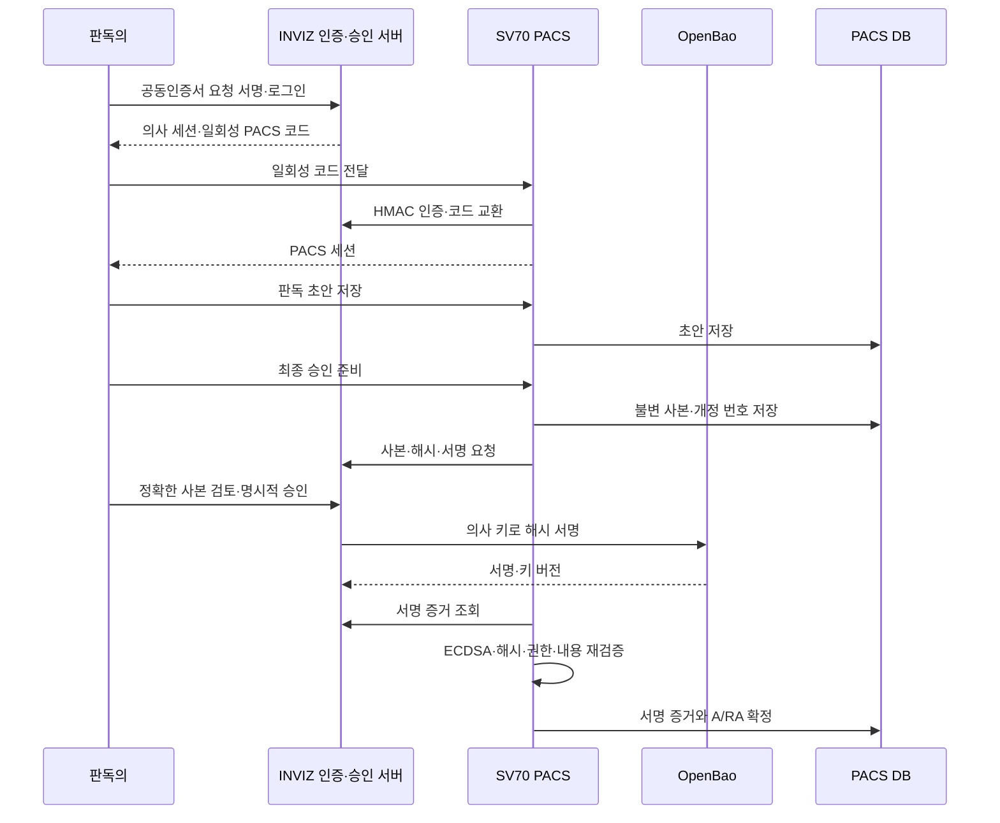

# SV70 PACS 공동인증서·판독문 서명 연동

작성일: 2026-10-14. [[12_인증서등록_설계변경]]의 인증 구조를 SV70 PACS FastAPI·React 소스에 적용한다.

## 실제 업무 흐름

1. 판독센터 관리자가 INVIZ 의사를 사전등록하고 신원·면허 증빙을 검토한다. PACS 사용자 번호와 INVIZ 기관·Doctor ID는 관리자가 명시적으로 연결한다. 이메일이 같다는 이유로 연결하지 않는다.
2. 의사는 인증 모듈에서 공동인증서를 선택하고 INVIZ의 일회성 요청에 서명한다. 개인키·비밀번호는 의사 PC에 남는다.
3. INVIZ가 서명·인증서 체인·유효기간·폐지 상태를 확인하고, 의사의 이용 동의와 관리자 검토를 기록한다. 이후 의사별 OpenBao 서명키와 내부 인증서를 활성화한다.
4. 인증된 의사가 PACS 로그인용 일회성 코드를 발급받는다. PACS 서버는 기관 범위가 정해진 HMAC 서비스 인증으로 코드를 교환한 뒤 등록된 사용자 연결과 활성 상태를 확인한다. PACS 전용 세션만 발급하며 INVIZ 의사 토큰을 서버 사이에 공유하지 않는다.
5. 판독 중 저장은 초안 저장이다. 최종 승인 요청 시 PACS 서버가 DB의 판독 내용·결론·검사·의사·개정 번호를 고정된 JSON 사본으로 만들고 SHA-256을 계산한다.
6. 의사는 서명할 정확한 사본을 확인하고 최종 승인한다. INVIZ는 인증서·의사·면허·권한·현재 판독 버전을 재검증하고 OpenBao로 서명한다.
7. PACS는 INVIZ에서 서명 증거를 조회하고 저장된 사본에 대해 ECDSA를 검증한다. 작성자·배정·현재 내용이 여전히 일치할 때 승인 상태(A/RA)와 서명 기록을 같은 DB 트랜잭션에서 확정한다.

## 관리와 장애 처리

- 공동인증서는 신원·로그인용이고 OpenBao 키는 판독문 서명용이다. 외부 공동인증서로 판독문 자체를 서명했다고 표시하지 않는다.
- 로그인·초대·연동 코드는 한 번만 사용하고 짧은 유효기간을 적용한다. PACS 세션 원문은 DB에 보관하지 않고 SHA-256만 저장한다.
- `PREPARING → PENDING_SIGNATURE → SIGNED_REMOTE → APPROVED`로 구분한다. 서명은 완료됐지만 PACS 저장에 실패한 경우 `SIGNED_REMOTE`와 기존 서명을 보존하고 재처리한다. 통신 오류를 승인 완료로 표시하지 않는다.
- 서명 이후 내용이 달라졌다면 이전 증거는 보존하고 새 개정과 승인을 요구한다. 과거 승인·서명·감사 기록은 삭제하거나 덮어쓰지 않는다.
- 연동 활성화 시 기존 판독 API의 A/RA 직접 저장을 차단한다. 관리자도 의사 본인의 최종 서명 승인을 대신할 수 없다.
- 모의 인증 결과는 운영용 PACS 로그인에서 거부한다. 운영 설정 누락이나 인증기관 확인 실패도 허용으로 바꾸지 않는다.

## DB와 소스 변경

PACS MySQL/MariaDB 주 스키마에 `pacs_vc_doctor_link`, `pacs_vc_session`, `pacs_vc_report_approval`, `pacs_vc_audit`를 추가한다. 원래 PACS 테이블은 이 마이그레이션으로 변경하지 않는다. 사용자 관리 DB와의 관계는 서버가 검증하고, 판독 상태 변경은 판독문과 같은 DB에서 수행한다.

검토 SQL: `database/sv70/001_vision_certi_integration.sql`. 원본 서버의 `sql/2026-10-14_vision_certi_integration.sql`에도 동일하게 제공한다. 실제 MariaDB에서 중복 연결, 만료, 사본·서명·감사 기록 변조 방지와 연결 재생성 후 보존을 검증한다.

GitHub에는 원본 인수인계의 비밀정보를 제외하고 인증 서버·웹·DB·운영 문서와 `integrations/sv70` 연동 묶음을 보관한다. 연동 묶음은 원본 SHA-256 검증을 통과한 파일만 백업 후 적용한다.

## 실사용 배포에 필요한 외부 설정

공동인증서 로컬 SDK의 실제 공급업체 인터페이스, 신뢰할 CA·폐지목록 갱신 체계, 모바일 인증기관 계약, 관리자 OIDC, 운영 DB·TLS·OpenBao 접근 권한을 기관 환경에 맞게 설정해야 한다. 모바일 인증과 SMS가 설정되지 않았다면 사용 불가 상태를 표시한다.

운영 데이터 영속화와 인증 설정은 `apps/backend/docs/PRODUCTION_RUNTIME.md`, 변경 코드와 검증 현황은 `docs/DEVELOPMENT_STATUS.md`를 기준으로 확인한다. 개발 테스트 인증서는 실제 공동인증기관 가입·면허 검증을 대체하지 않는다.
