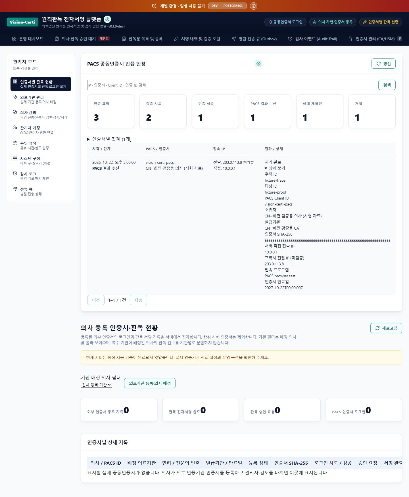

## 요청과 결과

사용자가 다른 PC의 공동인증서 로그인 성공을 확인했다. 이후 요청한 인증 내용·접속 IP·인증서 상세 정보를 서버 DB에 계속 기록하고 사이트에서 확인하도록 요청했다.

PACS 인증 확인 전용 경로에 요청 발급, 검증 시도, 인증 성공, 일회용 코드 교환, 유효 상태 재확인, 거절 기록을 연결했다. 관리자의 **인증서별 판독 현황**과 **감사 로그**에 새 패널을 추가했다. 인증서별 집계, IP/인증서/Client ID 검색, 상세 보기, 페이지 이동, 30초 자동 갱신을 지원한다. 설명은 `i` 도움말에 정리했다.

## 운영 DB에서 확인한 사실

배포 전 기존 `vision-certi-pacs` 범위에 검증 시도 11건, 성공 10건, 거절 1건이 있었다. IP가 저장된 기존 행은 0건이었다. 이 수치는 원격 PC 한 대의 로그인 횟수가 아니라 해당 연동 클라이언트의 전체 서버 검증 기록이다.

기존 기록이 관리자 화면에서 누락된 원인은 새 인증 확인 전용 흐름이 `clientId`를 감사 tenant로 사용하고, 기존 화면은 의사 등록 기반 로그인만 집계했기 때문이다. 신규 기록을 실제 기관(`inviz`)에 저장하도록 고쳤다. 과거 체인은 수정하지 않고 단일 기관으로 귀속이 명확한 경우에만 읽어서 표시한다.

배포 후 공개 두 API 경로의 challenge 발급으로 신규 요청 2건에 IP가 저장됐음을 운영 PostgreSQL에서 확인했다. 점검 요청에는 `VisionCertiDeploymentCheck/2026-10-22` User-Agent를 넣었다. 같은 시점에 실제 서버의 `PROOF_AUDIENCE_INVALID` 거절 1건도 IP와 함께 기록돼 있었다. 과거에 수집하지 않은 IP·발급기관 등을 소급 생성하지 않았다.

## 저장 범위와 한계

저장 위치는 기존 `certi_rt.audit_events`의 영속 JSONB와 기관별 감사 해시 체인이다. 운영 proof 행의 만료·정리와 별개로 기록을 보존한다. V010 스키마 그대로 동작하며 운영 DB 마이그레이션이나 데이터 삭제를 하지 않았다.

서버 시각, Client ID, 요청/인증 ID, 추적 ID, 직접 연결 IP, 프록시 전달 IP, 접속 프로그램, Origin, 결과와 오류 코드, 검증된 인증서 지문·소유자·발급기관·유효기간·일련번호를 기록한다. 전달 IP는 미검증 참고 정보로 구분한다.

현재 PACS는 확인 전용 요청에 계정 ID나 PC 이름을 전송하지 않는다. 인증서 비밀번호와 개인키는 PC에서만 사용하며 서버 감사 기록에 저장하지 않는다. PACS 비밀번호·토큰·HMAC 키·일회용 코드를 기록하지 않는다. 인증 성공/결과 교환/상태 재확인을 PACS 로그인 완료나 판독 승인 완료로 바꾸어 집계하지 않는다. 상세 계약은 [[PACS_인증기록_대시보드]]에 기록했다.

## 검증

- 백엔드 25개 통과(관련 회귀 23개와 추가 HTTP 검사 2개): 인증 흐름, 실제 PostgreSQL 저장, 재시작 후 보존, 만료 proof 정리 후 보존, 잘못된 서명·코드 재사용 거절, 기관 격리, 관리자 제한, 과거 체인 불변성, 헤더/비밀값 제외. HMAC 인증 실패가 DB에 저장되고 관리자만 조회할 수 있음을 메모리/실제 PostgreSQL 양쪽에서 확인했다.
- 웹 18개 통과: 관리자 메뉴/권한, 인증 코드 전달, 검색/페이지 이동, 자동 갱신·unmount 정리, 이전 기관의 늦은 응답 폐기.
- Edge 실제 렌더링 검사에서 대시보드와 상세 증거가 표시되고 JavaScript 오류가 없음을 확인했다. 아래 화면은 격리된 시험 응답으로 촬영했으며 운영 DB에 시험 의사·인증서를 넣지 않았다.
- 공개 운영 로그인 및 이전 JS 주소의 대체 로딩, JS 로딩 실패 복구 안내를 브라우저에서 확인했다. 흰 페이지/요청 실패/JavaScript 오류 없음.
- 공개 관리자 API에 토큰 없이 접근하면 HTTP 401로 거절한다. 정상 challenge 발급은 201, health는 200이다.



## 배포

Cloud Run `vision-certi-api-00013-zrf` 정상 준비 완료. 이미지 digest는 `sha256:68c87441d519480f2fed246fbec35cde2c75ad3aa8a150d784ef459cfea05331`, 배포 ID는 `2026-10-22-pacs-activity`다. 기존 운영 설정을 읽어 API 이미지/배포 ID만 갱신했다.

`https://vision-certi.web.app`, `https://hahattalk-vision-certi.web.app` 및 각 `.firebaseapp.com` 별칭에서 HTML/JS가 최종 빌드와 동일하고 HTTP 200, no-store, 이전 JS 주소 대체 응답이 정상임을 확인했다. `vision-certi-preview` 채널도 최신 live 버전으로 복제했다. 기존 주소의 페이지는 기준 주소로 이동한다. 브라우저 API Origin 허용 값은 기존 기준 주소를 유지한다.

최종 JS는 `index-B_3fEWSt.js`다. 검사 명령:

```powershell
$env:VISION_CERTI_RELEASE_DIR='C:\Project\Vision-Certi\work\hosting-pacs-activity-final'
node infra/cloud/Check-WebDeployment.cjs
node tests/browser/pacs-activity.cjs
```

공유 작업 폴더에는 이번 작업 전부터 인증 팝업/설치 스크립트의 별도 수정본이 있었다. 이를 보존하고, Git 기준본에 이번 웹 변경만 적용한 `work/pacs-activity-release`에서 빌드한 뒤 `work/hosting-pacs-activity-final`에 고정해 두 사이트에 배포했다. 배포 중인 Windows 설치 파일과 PACS 3.40.5/3.40.6 다운로드를 유지했다. 인증서 프로그램 ZIP의 SHA-256이 현재 배포된 `ce34dc780122c172c6ffebd65c4cabb41bceea1a732778207b1891e108969bb9`와 일치하도록 빌드 환경 설정도 포함했다.

Git 저장소는 이미 초기화되어 있어 재초기화하지 않았다. 이번 변경 파일만 기존 작업 브랜치에 커밋·푸시하며, 별도 작업 중인 수정본은 그대로 보존한다. 보고서와 시험 화면은 사용자 Obsidian의 `Vision-Certi` 폴더에도 복사한다.
