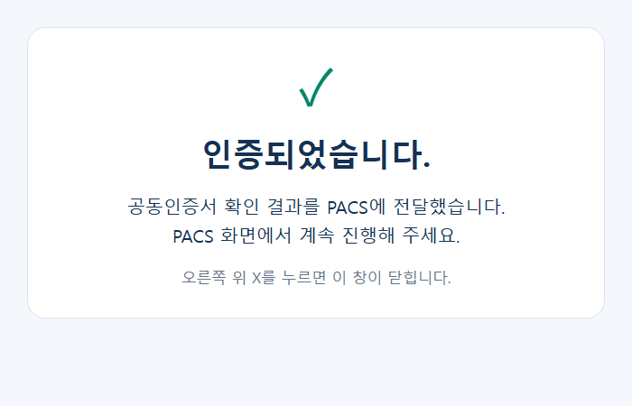
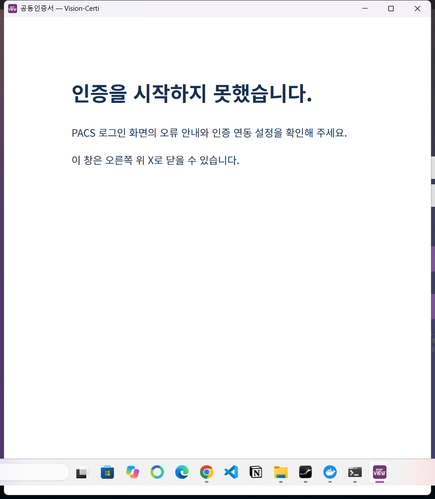

## 다른 PC의 3.40.5 재발 보고

사용자는 다른 PC에서 3.40.5를 설치한 뒤에도 흰 창이 남는다고 보고했다. 이 PC에서 기존 WebView2 프로필을 공유해 3.40.4→3.40.5를 실행한 결과 각 버전의 서로 다른 JS 파일이 정상 로드됐다. 따라서 업데이트 캐시가 원인이라고 단정하지 않는다. 테스트용 PACS 로그인 성공 후 화면 전환까지 확장해도 이 PC의 3.40.5에서는 완료 화면이 유지됐다. 다른 PC의 WebView2 상태는 직접 확인하지 못했다.

## 실제로 발견한 배포 불일치

| 주소 | 점검 전 JS | 점검 전 상태 | 조치 후 |
| --- | --- | --- | --- |
| vision-certi.web.app / firebaseapp.com | index-BR3O8v2V.js | 최신 완료 문구, no-store | 최신 유지 |
| hahattalk-vision-certi.web.app / firebaseapp.com | index-DwngTHl-.js | 이전 코드, 1시간 캐시, 이전 파일 대체 없음 | 최신 파일과 헤더로 재배포 |
| 기존 vision-certi-preview 채널 | index-BdBkZPE6.js | 이전 코드, 1시간 캐시 | 최신 live 버전을 복제 |

기존 사이트에도 새 주소로 이동하는 코드가 있었으므로 배포 불일치만으로 흰 창의 원인을 확정하지 않는다. 조치 후 다섯 도메인의 HTML·JS 해시가 로컬 빌드와 일치하고, 완료 문구·HTTP 200·no-store·폐기된 JS 주소의 최신 파일 응답을 확인했다. Edge 자동화로 운영 두 주소와 미리보기 주소를 열어 요청 경로/nonce가 유지된 채 기준 주소로 이동하고 React가 실제 표시되는 것도 확인했다. 두 운영 사이트의 재검사 도구는 `infra/cloud/Check-WebDeployment.cjs`다.

## PACS 3.40.6 보완

- PACS가 origin/source/nonce/audience가 일치하는 인증 결과를 받으면 웹 팝업과 독립된 로컬 완료 창을 연다. 완료 창에는 외부 네트워크·React·opener가 필요 없다.
- 완료 창을 로드한 뒤 원래 팝업의 네이티브 프레임을 제거한다. 이 처리는 인증 결과 표시만 하며 PACS 세션이나 인증 증명을 생성하지 않는다.
- 초기 PACS 로그인/설정 확인 동안 빈 예약 창에 진행 메시지를 표시한다. 시작 실패 시 안내를 남기고 `window.close()`로 흰 프레임을 만들지 않는다.
- 새 PC의 브로커는 Client ID를 빈 문자열로 생성하고 있었다. 기본 Vision-Certi 주소에서 누락된 공개 ID만 `vision-certi-pacs`로 보완한다. 다른 서버·API override·기존 ID는 보존한다.

회귀 검사에서는 시험 인증서의 잘못된 비밀번호를 거절하고, 올바른 비밀번호로 개인키를 복호화해 실제 RSA 서명을 확인했다. 인증 서버 응답 직전에 웹 React root를 강제로 제거해 흰 화면을 만든 뒤에도 독립 완료 창이 표시되고, 시험 PACS의 로그인 화면 전환 후에도 유지됐다. 실제 계정/PACS 서버 요청은 시험 응답으로 격리했다.

최종 실행 파일의 성공 경로와 초기 PACS 로그인 거절 경로를 모두 실행했다. 거절 시에는 인증 결과를 전송하지 않고, 실제 Windows 창의 접근성 트리와 화면에서 아래 오류 안내를 확인했다. 프런트엔드 21개, 브로커 관련 20개 테스트를 통과했다. 패키징한 새 브로커 EXE를 격리한 Windows 사용자 데이터 폴더에서 실행해 Client ID 자동 설정·기존 ID 보존·HMAC 경로 미생성을 확인했다.

## 배포 파일

설치 파일: [SaintViewPACS 3.40.6](https://vision-certi.web.app/downloads/saintview-pacs-3.40.6-setup.exe), [보조 주소](https://hahattalk-vision-certi.web.app/downloads/saintview-pacs-3.40.6-setup.exe). 소스 커밋은 `7cc8ad8` (`fix/certificate-completion-window`)이며 Windows 파일 버전은 `3.40.6`이다. 설치 파일 크기는 171,935,754바이트, SHA-256은 `91dabbdb82c270cf7db2c920e92674a3e2cc238aeb61aadf920034f5a2c459bd`다.

두 운영 사이트에 배포한 뒤 각 주소에서 설치 파일 전체를 다시 다운로드해 SHA-256 일치를 확인했다. 웹 파일과 캐시 설정도 두 사이트와 별칭 주소에서 다시 검사했다. 동시에 작업 폴더에서 진행 중이던 별도 웹 소스 변경은 포함하지 않고, 공개 배포본을 고정한 사본에 설치 파일을 추가해 배포했다.

## HMAC 질문에 대한 확인

현재 HMAC 자동 발급/PC 설치 기능은 없다. 배포 설정은 Secret Manager의 `vision-certi-pacs-hmac-secret`을 인증 서버의 `/run/secrets/pacs-hmac/value`에 연결한다. PC는 `%LOCALAPPDATA%\SaintViewPACS\CertificateAuth\broker-config.json`의 `VISIONCERTI_PACS_CLIENT_SECRET_FILE` 경로를 읽는다. 이 PC에서 확인한 해당 값은 빈 문자열이었다. 비밀키 내용은 읽거나 배포하지 않았다.

공개 Client ID 설정과 인증 결과를 교환할 비밀키 설정은 다르다. 이 수정은 HMAC 인증을 우회하지 않고, 공용 키를 설치 파일에 포함하지 않는다. 다른 PC의 실제 PACS 로그인 성공과 HMAC 자격증명 공급까지 검증한 것으로 해석하면 안 된다.
